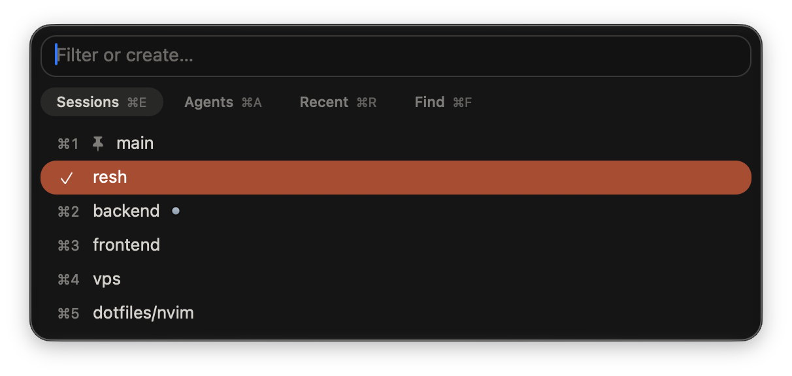
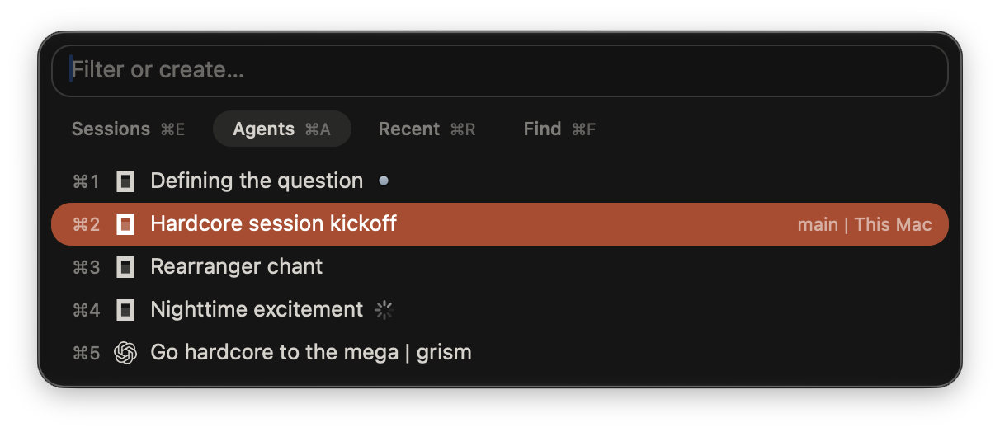

# resh

A macOS session manager for [Rex](https://www.superlogical.com/rex), inspired by
[sesh](https://github.com/joshmedeski/sesh). Resh lets you instantly jump
between sessions and agents across multiple hosts.

<p align="center">
  <sub>Session picker</sub><br>
  <br>
  <sub>Agents dashboard</sub><br>
  
</p>

- Fuzzy-find and open frequently visited directories with `zoxide`
- Find other directories with `fd`
- Configure projects with a session name, directory, and startup command (e.g. open
  an editor or start a dev server)
- Switch between local and remote Rex sessions
- Manage your agents across multiple machines
- Add custom views populated by directory lists or commands
- Customize keyboard shortcuts. Make them tmux-style if that's where you're
  coming from.

## Install

Requires macOS 15+ and Rex. Rex is currently in closed beta and does not provide
a proper API for a plugin such as resh, so things might and will likely break.

Enable **Rex Settings → Rex Server → Remote Control** to allow session switching.

```sh
brew install CruelAddict/tap/resh
resh setup
```

To find directories with `Recent` and `Find`, also install `zoxide` and `fd`
(they're optional but highly recommended):

```sh
brew install zoxide fd
```

Set up [`zoxide`](https://github.com/ajeetdsouza/zoxide#installation) to
track the directories you visit.

## Using resh

Press `⌘S` in Rex to open resh. Choose the `Sessions` view to switch to an open
session, `Recent` to find a directory you've visited, or `Find` to discover
another directory. Selecting a directory creates a session there, or returns to
the one you opened through resh before.

If you have a harness open in one of your sessions, the `Agents` view appears so
you can use it for status monitoring and navigation.

### Default shortcuts

| Key | Action |
| --- | --- |
| `⌘S` | Open or close resh in Rex |
| `⌘L` | Switch to the previous session in Rex |
| `⌘E` | `Sessions` — switch to an open session |
| `⌘R` | `Recent` — open a `zoxide` directory as a session |
| `⌘F` | `Find` — search directories under your home folder with `fd` |
| `⌘P` | `Projects` — open a configured project (the view is visible if you have at least one configured) |
| `⌘A` | `Agents` — agent panes across all sessions, when available |
| `⌘1–9` | Open by number |
| `⌘⇧P` | Pin or unpin the selected session |
| `⌘⇧N` | Create a session named after the search text |
| `⌘⇧D` | Immediately close the selected session and its programs |
| `↑` / `↓`, `⌃P` / `⌃N` | Move through the list |
| `Tab` / `Shift-Tab` | Switch to the next or previous view |
| `Enter` | Open the selection |
| `Esc` / `⌃[` | Close the picker |

## Configuration

Resh is configured in `~/.config/resh/config.toml` (apply with `resh service restart`).

See [`config/default.toml`](config/default.toml) to learn more about
resh's default configuration.

### Projects

A project is a pre-configured session shortcut, e.g.:

```toml
[[session]]
name = "Backend"
path = "~/work/backend"
startup_command = "nvim"
```

[See more in examples](config/custom.toml).

### Custom views

Specify your own command to supply candidates for the picker.

```toml
[[sources]]
name = "Work"
type = "command"
cwd = "~/work"
command = ["fd", "-t", "d", "-d", "2", ".", "."]
```

The name is also used in source order, unions, and the `resh_source` action.
Names are case-sensitive; renaming a source means updating its references.

[See more in examples](config/custom.toml).

### Custom shortcuts

Add bindings **after** the installed resh integration in Rex's `init.lua`:

```lua
rex.bind("resh/ctrl+[KeyJ]", "resh_next")
rex.bind("resh/ctrl+[KeyK]", "resh_previous")
```

Bindings prefixed with `resh/` apply only inside the picker.

See the [default shortcuts](config/keymap-default.lua) and
a [tmux-style configuration example](config/keymap-custom.lua).

## Remote hosts

resh shows the same local and remote sessions you see in Rex.

To have `Recent` and `Find` discover directories on a remote host,
install the remote resh adapter on it:

```sh
bash install.sh --remote
```

The remote machine also needs to have `zoxide` and `fd` configured.
